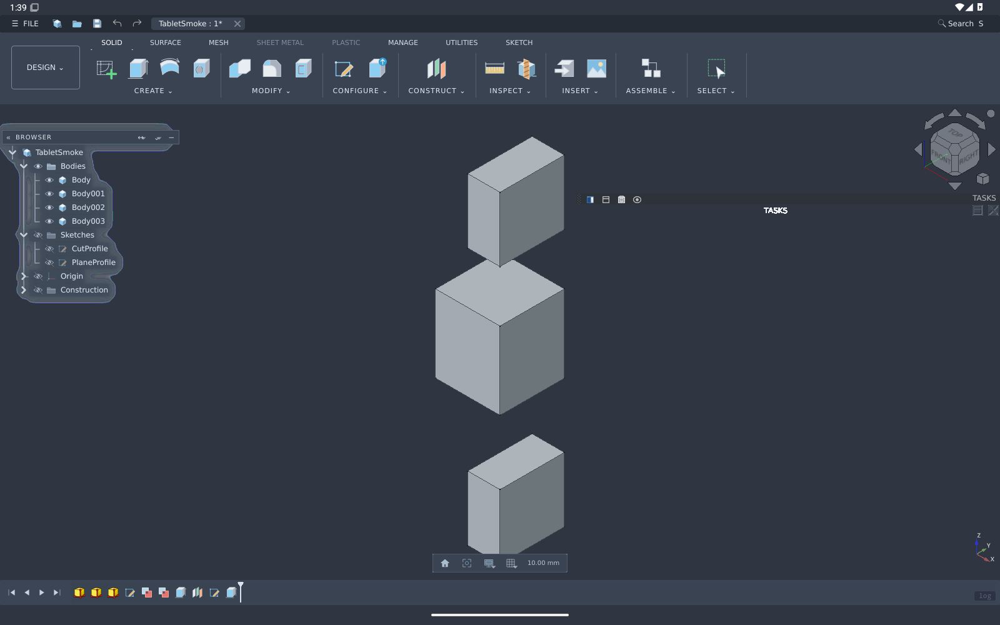

# FreeCAD + FusionFlow for Android

An **experimental, offline Android edition of FreeCAD 1.1.3**, with the FusionFlow
interface included. It runs the actual FreeCAD application, Python interpreter,
Open CASCADE geometry kernel and Qt interface on the device through WebAssembly.
There is no remote desktop or modelling server.

**[Download the APK](https://github.com/Jirkas-prog/freecad-android/releases/download/v0.1.0-alpha.1/FreeCAD-FusionFlow.apk)** ·
[Česky](docs/README.cs.md) · [Verification](docs/VERIFICATION.md) · [Licences](NOTICE.md)

This is an independent community port. It is not an official release of FreeCAD,
Autodesk or Samsung. The APK is a WebView host for a WebAssembly build, **not a
native ARM64 build of FreeCAD's C++ libraries**. Its interface is still a desktop
CAD interface adapted for a tablet.



## Requirements

- Android 10 or newer; a landscape tablet and keyboard/trackpad are recommended.
- A recent Android System WebView supporting **cross-origin isolated allowlists**,
  WebAssembly memory64, JSPI, shared memory and WebGL2. The application checks these
  capabilities before starting. A version supporting JSPI alone is insufficient.
- At least 8 GB device RAM and 2 GB free storage are recommended for small models;
  these are sizing recommendations, not a tested hardware guarantee.
- The verified environment is Android 15 x86_64 in an emulator, with Chromium
  WebView **158.0.8113.0**. Samsung Galaxy Tab S9 hardware has **not** been tested.
  A stock WebView may not yet expose the required isolation API.

Install the APK, allowing installation from the browser/file manager when Android
asks. FusionFlow loads automatically. No separate FreeCAD installation, account,
server address or add-on installation is required. The APK includes the engine;
after installation it does not download CAD components. The first start can take
over a minute while WebView compiles and starts the engine.

If the app says **WebView update required**, update Android System WebView through
its normal trusted distribution channel. Do not disable browser security or install
an arbitrary WebView APK. If the required feature is still unavailable, this
edition cannot run on that provider yet.

## Modelling and controls

FusionFlow provides its top ribbon, grouped browser, bottom feature history,
sketch tools, face extrusion, selectable multi-body cuts and construction tools.
It is bundled from the separately maintained
[FusionFlow add-on v0.20.0](https://github.com/Jirkas-prog/freecad-fusion/releases/tag/v0.20.0).
See that project's feature descriptions and modelling limitations.

In **DESIGN → Input**, choose:

| Mode | Intended input |
| --- | --- |
| Touch / pen | Tap to select, one-finger drag to orbit in the 3D view, two-finger drag to pan, pinch to zoom. Sketch tools interpret taps as drawing input. |
| Mouse / trackpad | FreeCAD's Revit navigation preset, suitable for an attached pointer and keyboard. |

The chosen mode is saved. S Pen pressure, barrel-button actions, palm rejection and
Samsung DeX-specific behaviour are not custom implemented or hardware verified.
There is no cursor-warping orbit in this WebAssembly edition.

## Files and offline use

Use **File → Open** / **Ctrl+O** to choose a file through Android's document picker.
Use **Save** / **Ctrl+S** to export a `.FCStd` document to a folder you choose.
FreeCAD's file bridge also supports its usual supported import/export formats.
The native export bridge accepts files up to 512 MB.

The app maintains local session recovery in WebView storage. **Export important
work to a real document file**: uninstalling the app or clearing its data removes
its private recovery storage. Recovery is not a substitute for a backup. Custom
FusionFlow construction/analysis objects need the add-on on the receiving desktop;
native FreeCAD features remain native `.FCStd` features.

The manifest requests **no Internet or broad storage permission**. The engine is
served from packaged assets at one private WebView origin. Other origins are
blocked. Telemetry is removed, online add-on installation and shared sessions are
disabled, and files leave private app storage only through a user-chosen document
provider. A selected cloud document provider may itself use the network.

## Scope and limitations

- This is an alpha release, suitable for testing small models, not a certified
  replacement for desktop FreeCAD.
- The release is tested in an emulator. Physical ARM64 devices, stylus behaviour,
  accessibility and large assemblies still need a hardware test matrix.
- FreeCAD's Python UI, dialogs and graphics run through a browser runtime; some
  desktop extensions assume subprocesses, native modules or unrestricted file paths.
- External FEM solvers, 3Dconnexion software, server collaboration and online
  Addon Manager installation are not included.
- Available workbenches are those compiled into the pinned upstream engine.
  Presence in a menu does not certify every command in that workbench.
- The WASM engine's memory ceiling and Android's process limits can terminate a
  large model session. Export frequently.
- The core engine is supplied by **Virtastic/freecad-web**. This repository adds
  Android packaging, offline confinement, document-picker export/import and the
  FusionFlow integration; it does not claim authorship of that port.

## Build

Prerequisites: Git, Python 3.10+, curl, JDK 17 or 21, Android SDK platform 35 and
build-tools 35.0.0. Set `ANDROID_HOME` or use an untracked `local.properties`.

```sh
python tools/prepare_runtime.py
./gradlew :app:assembleDebug
```

On Windows use `gradlew.bat`. The preparation script clones the pinned upstream
source and downloads engine/add-on artifacts into `build/cache`, verifies their
SHA-256 hashes, applies the upstream GL fixes and our offline adaptations, then
generates `app/src/main/assets/engine`. These generated binaries are not committed.
The script refuses an unexpected engine commit or checksum.

For an unsigned release build:

```sh
./gradlew :app:assembleRelease
```

Sign it using your own Android signing key and `apksigner`; retain that key privately
for upgrades. Do not commit a keystore, passwords or `local.properties`. The source
and manifest make it possible to replace the engine or add-on and rebuild; changing
either pinned version requires compatibility testing and new checksums.

**Reproducibility boundary:** APK assembly uses exact, hashed upstream binaries.
Rebuilding the complete FreeCAD/Qt/OCCT toolchain is a separate upstream process.
The pinned upstream `BUILD-WEH.md` documents missing dependency-version records;
this project does not claim a reproducible full engine rebuild from source.
See [NOTICE.md](NOTICE.md) for the corresponding source locations and patches.

## Repository layout

| Path | Purpose |
| --- | --- |
| `app/` | Android host and native file bridge |
| `runtime/versions.json` | Pinned engine/add-on versions and artifact hashes |
| `runtime/start.py` | FusionFlow installation and tablet input menu |
| `runtime/android-bootstrap.js` | Boot integration and chunked native exports |
| `tools/prepare_runtime.py` | Offline runtime assembly and adaptations |
| `tools/serve_test.py` | Local development server with isolation headers |
| `tools/test_runtime.cjs`, `tests/` | CAD regression check through a debug WebView |
| `docs/` | Installation, test evidence and limitations |

Please include the app version, WebView provider/version, Android version, device,
input mode and a minimal non-private model when reporting a bug. Never attach a
personal document without checking its contents.
